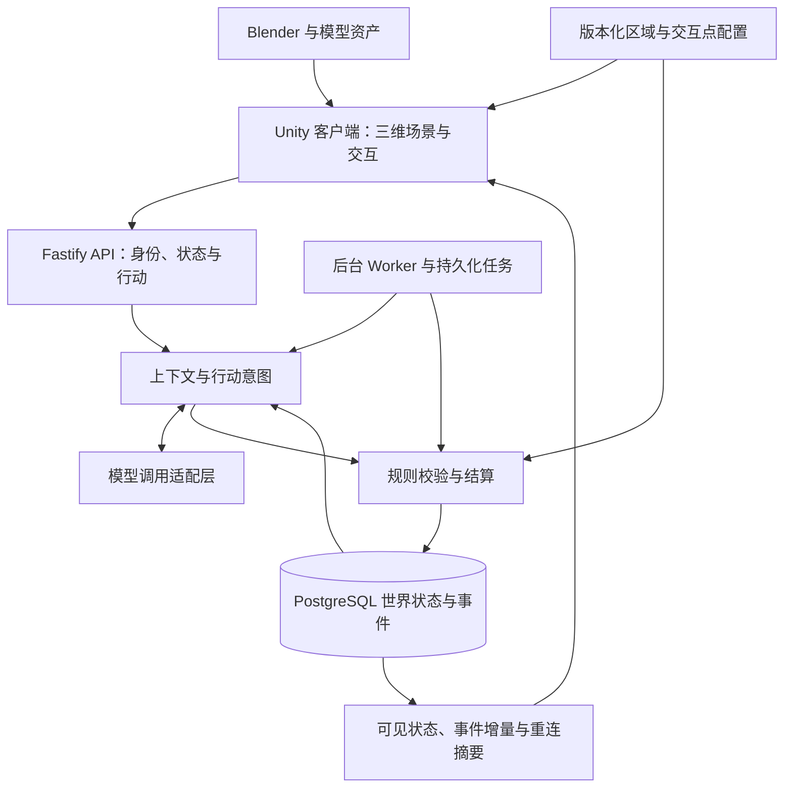

# Real World：短期 MVP 构建规划

| 项目 | 内容 |
| --- | --- |
| 文档版本 | 0.2 |
| 更新日期 | 2026-11-26 |
| 状态 | 构建依据；尚未实现，所有指标均为拟定验收目标 |
| 前置阅读 | [游戏介绍与交接入口](README.md) |
| 后续方向 | [长期规划](ROADMAP.md) |

## 1. MVP 要证明什么

MVP 面向开发者本人及少量受邀朋友，每人拥有独立世界。目标是在一个小范围的 Unity 三维园区中完成能够反复体验的逃生过程，验证 AI 人物关系是否能形成有趣且可解释的故事。

核心问题如下：

1. NPC 是否记得重要经历，并在后续行动中体现这些经历？
2. 玩家是否需要理解人物的利益与信息，而不仅是重复提高好感度？
3. 相似开局下，不同选择能否产生有原因的不同结果？
4. 世界在玩家离线时继续运行，是否增加期待，而不是制造惩罚？
5. 在质量和延迟可接受的条件下，一个独立世界每天消耗多少费用？
6. 三维移动、角色表现与云端状态能否保持一致，资产制作和客户端性能是否可控？

验收需要同时覆盖系统正确性和真实试玩。对话听起来像人、接口可以调用、类型检查通过，都不能单独证明游戏成立。

## 2. 范围与推荐基线

### 2.1 已确认范围

- 原创背景与人物，单人独立世界，优先逃生与人际博弈。
- 游戏主客户端采用 Unity + C#；首版包含三维场景、可控制角色、基础动画与场景交互。
- 云端持续推进 NPC 活动，离线主角受保护。
- 主角死亡结束本局，玩家不能回滚；系统自动持久化。
- 内部及少量朋友体验，暂不公开收费。

### 2.2 用于构建和估算的推荐基线

Unity 三维路线已确定。下列规模、设备、视角和配套技术属于推荐基线，不代表已经实现或被逐项确认。开始构建时应将实际采用值记录在项目配置与本节中。

| 项目 | 推荐基线 | 采用理由 |
| --- | --- | --- |
| 客户端 | Unity + C#，使用项目启动时仍受支持的 LTS 版本 | 使用成熟的三维场景、动画与交互工具链 |
| 设备与操作 | Windows PC、键鼠、第三人称跟随镜头 | 作为首版估算与验收基线，具体配置在 M0 确认 |
| 渲染与美术 | 推荐 URP，中低复杂度三维资产，先灰盒后替换美术 | 将画面表现与内容制作控制在可验证范围 |
| 地图 | 6 个功能区域组成一个可走动的小园区，另设外部安全目标区域 | 在有限场景内验证空间、关系和逃生，不先做超大地图 |
| 人物 | 20 名成年具名 NPC，均可对话和做关键决定 | 能形成关系网络，也便于人工观察 |
| 势力 | 3 类利益群体，个体可持不同立场 | 产生冲突而不预设每个人的行为 |
| 同时体验人数 | 首轮最多 5 个受邀账号 | 便于观察、反馈和控制总成本 |
| 活跃世界 | 每账号同时 1 个 | 避免无意间开启多个持续计费世界 |
| 时间 | 初始按 1 现实分钟＝5 游戏分钟，在线离线一致 | 便于短期观察作息，避免切换在线状态改变时间速度 |
| 后台调度 | 宏观日程每现实分钟检查；在线短时事件采用秒级到期检查 | 与逐帧移动分开，不让人物交互等待分钟级扫描 |
| 技术组织 | Unity 客户端、Node.js + Fastify API、独立 Worker、PostgreSQL + Drizzle | 世界规则集中在服务器，初期保持部署简单 |
| 任务与部署 | 推荐 pg-boss 管理持久化任务；服务端使用 Docker Compose | 复用 PostgreSQL，支持进程重启后的任务恢复 |
| 开发语言 | 客户端 C#，后台 TypeScript，以接口契约和数据样例协作 | 不把 C# 与 TypeScript 当成可直接共享的源码类型 |
| 建模与资源 | Blender、FBX 导入、Unity Prefab、Addressables | 建立可复用资产及按区域加载的流程 |

不对首局时长作成功承诺。先组织每次 30～60 分钟的观察试玩，记录玩家推进速度，再调整节奏。游戏时间比例可以在测试世界之间调整，同一局中不得无提示改变。

### 2.3 不纳入 MVP

不实现生育、未成年人成长、遗传疾病模拟、复杂经济市场、多人共享世界、跨局属性成长、超大无缝地图、精确潜行与动作战斗、语音对话、付费商城和开放用户内容创作。移动端、VR 和 WebGL 暂不列入首版验收。

不为这些远期能力预先建设通用插件系统、全套遗传数据库或分布式世界架构。首版不要求所有模型从零制作；先用灰盒和来源清楚的可复用资产完成三维玩法闭环。

## 3. 游戏内容与玩家体验

### 3.1 原创场景最小集合

| 地点 | 主要作用 |
| --- | --- |
| 生活区 | 认识人物、观察关系、进入休息状态 |
| 工作区 | 获取资源、接触利益冲突与日常安排 |
| 公共活动区 | 交换信息、看到 NPC 之间的互动 |
| 物资区 | 体现资源所有权、交换和权限限制 |
| 管理区 | 体现权力、身份、规则与压力 |
| 边界区 | 汇合逃生条件，执行高风险的最终行动 |
| 外部安全区域 | 仅作有效逃生的结算目标，不扩展为新的可玩区域 |

玩家能实际走过园区、进入允许访问的房间、接近 NPC 和物品。首轮可在一个 Unity 场景中完成灰盒搭建，先标注区域、门、通道和交互点，再按加载及协作需要拆分场景。

推荐使用 Unity 的输入与角色控制组件实现移动，利用 Cinemachine 处理镜头，利用 AI Navigation / NavMesh 实现 NPC 局部寻路。门权限与区域连接必须与服务器配置一致，角色不能在画面中穿过规则判定为关闭的入口。

### 3.2 人物内容准备

每名 NPC 至少要有一份简短小传、两三个稳定行为倾向、当前主要诉求、初始日程、已知信息和少量初始关系。初始状态不能要求每个人都围绕玩家行动。

3 类利益群体可暂定为受困者、秩序执行者和资源中间人；这是内容组织方式，不是固定善恶阵营。每组都应存在利益分歧和跨组关系。

为测试准备少量明确的初始矛盾，例如资源分配不均、互不信任、未履行的承诺和对同一消息的不同理解。具体人物响应由当局状态决定，不写成必须按顺序触发的剧情链。

20 名具名 NPC 不要求制作 20 套完全独立的人体和骨骼。首版优先复用 Humanoid 骨骼、基础体型与动作，通过服装、发型、颜色及少量外观差异区分人物；人物身份和记忆不随模型替换而改变。

### 3.3 最小行动集合

| 行动 | MVP 中的具体能力 | 关键限制 |
| --- | --- | --- |
| 观察 | 查看在场人物、公开事件和可见物品 | 不读取 NPC 的内心、完整关系数值或隐藏库存 |
| 移动 | 控制角色在三维场景中行走、转向和经过通道 | 客户端处理操作与碰撞，服务器检查区域转换、权限和关键交互条件 |
| 交谈 | 提问、说服、承诺、隐瞒、表达态度 | 对话不能直接修改权威世界状态 |
| 给予与交换 | 接近交互对象，转移拥有的资源，提出并接受交换 | 资源不足、目标不可交互或条件变化时不能成交，动画不直接转移物品 |
| 请求与合作 | 提出一个现有行动能力支持的请求 | NPC 可以接受、拒绝、附加条件或随后改变决定 |
| 等待与休息 | 等待事件、恢复基础状态、进入离线休息 | 不能立即跳过时间并撤销他人的已发生行动 |
| 逃离尝试 | 在满足或部分满足条件时承担明确风险 | 必须由规则判定结果，模型不能直接宣告成功 |

玩家可以使用自然语言，但输入需要被理解为已支持的行动或对话。无法执行的意图应说明缺少的能力或条件，给出相关的可选操作，不伪造成功结果。

MVP 不提供独立战斗操作系统。危险行动以规则结算伤害、损失、退回原处或死亡，Unity 播放相应表现。客户端的碰撞回调、动画结束或视觉特效不能独立宣布死亡或逃生成功。

### 3.4 可组合的逃生机制

至少准备两种不依赖同一名 NPC、同一件唯一物品的逃生机制，用抽象条件组合表达，例如获得合作与可信信息，或准备足够资源并等待合适机会。两条机制都应在受控测试状态下能够成功。

玩家不必每次获得所有信息，也不必与所有人交好。条件可以提供不同风险水平；高风险尝试前应有可理解的风险提示，但不必公开隐藏概率和秘密。

不保证每一局都能轻松取胜。地图与资源设计应避免仅因玩家离线便永久清空所有可重新争取的机会，也不能依赖复活关键 NPC 来修补剧情。

### 3.5 核心界面与流程

首版包含开局与连接界面、三维游玩场景、结局回顾三类视图。游玩场景中的 Unity UI 提供交互提示、文字对话与行动面板、个人状态、已知线索和事件记录。

对话输入时切换输入焦点，避免打字同时驱动角色移动；模型请求等待期间保持渲染和基础镜头响应，禁止重复提交互相冲突的行动。调试信息放在开发者工具中，不向玩家展示提示词或隐藏判定参数。React 仅作为以后内部工具的可选方案，不是游戏主客户端的依赖。

| 阶段 | 玩家看到的内容 | 系统应完成的工作 |
| --- | --- | --- |
| 创建世界 | 基本背景、玩法说明与开始入口 | 创建独立初始状态，避免重复开局 |
| 首次进入 | 加载后的三维场景、可控制角色、附近人物和第一步提示 | 匹配世界与场景配置，恢复角色位置，提供可理解的目标 |
| 采取行动 | 接近对象后的提示、处理状态、动画及最终结果 | 验证、结算、保存，并仅展示玩家可知的信息 |
| 查看变化 | 状态改变、对话回应、可核对的事件 | 保持文本与实际状态一致 |
| 离开或断线 | 明确的断线或休息状态 | 已提交行动先结算，停止新交互，之后不自主冒险 |
| 重新进入 | 自己的状态、与自己有关的变化、可调查线索 | 从真实事件生成摘要，过滤未知秘密 |
| 死亡或逃生 | 明确结局、原因回顾和重新开始入口 | 本局只读，停止主动模拟，新开局重新初始化 |

玩家只能看到世界中的可观察信息和已经获知的消息。结局回顾可以揭示与本局结果直接相关的解释，但不得将这些知识自动带入新局 NPC 的记忆。

## 4. NPC、记忆与社会行为

### 4.1 决策输入

一个 NPC 的模型请求只包含当前相关的角色设定、目标、状态、所处环境、与当前对象的关系、有关记忆，以及当下可执行的行动范围。

全世界的事件日志不是每名 NPC 的共享记忆。观察、听闻和推测要区分来源；传言可能不准确，也不能因为多次摘要而变成无来源的确定事实。

### 4.2 决策触发

| 情况 | 是否需要模型 | 处理方式 |
| --- | --- | --- |
| 执行已有的吃饭、休息、移动日程 | 通常不需要 | 由规则执行当前计划 |
| 玩家主动交谈或提出合作 | 需要 | 基于局部上下文决定回应与行动意图 |
| 收到重要消息、遭遇损失或冲突 | 视影响程度触发 | 重新评估受影响的目标与计划 |
| 目标不可达、承诺到期、关系发生重要变化 | 需要或由规则先筛选 | 选择继续、调整或放弃 |
| 长时间没有关键变化 | 不需要反复请求 | 延续既有计划，保留必要的周期性检查 |

NPC 之间的接触也能触发交谈或交换，不需要玩家在场。日常闲聊可以使用简短摘要或已有规则，避免无意义对话占满模型预算。

服务器给出目标、活动状态和日程，Unity 根据已接受的计划执行局部导航、转身与动画。走路的每一帧不请求模型；无法通行或计划失效时，再由规则决定等待、取消或重新规划。

### 4.3 关系与承诺

首版关系采用少量可解释维度，推荐包含信任、畏惧及明确的承诺或欠情记录。无需预先建设几十项人格与情绪数值。

关系变化由已发生事件及角色倾向计算，模型可以提出解释，不能任意覆写分值。收到礼物可能增加善意，但不会自动消除恐惧、弥补严重背叛或保证合作。

NPC 的承诺不是无条件脚本。处境改变后可以违约，但需要有支撑该变化的事件或目标，且违反承诺会影响知情者的后续判断。

### 4.4 记忆最小方案

- 保留近期相关事件和重要经历；重要承诺、背叛、伤害与关键线索不能仅因对话变长而消失。
- 每条记忆能关联到来源事件、获知时间与信息来源；错误认识不等于世界事实。
- 首版优先按对象、事件类型、时间和重要性检索，不默认引入向量数据库。
- 需要摘要时，摘要引用原有记忆，不能生成新的事实；矛盾以权威事件记录和信息来源校对。
- 调试时能够回答“这个 NPC 为什么知道这件事”“这次决策用了哪段经历”。

不要求每轮聊天都重新反思人生。稳定倾向缓慢变化，当前情绪和策略可以随处境更快调整。

## 5. 系统结构与最小数据边界

### 5.1 结构建议



Unity 客户端负责操作和表现。推荐使用 Node.js + Fastify 提供 API，独立 TypeScript Worker 与 API 共用服务器领域规则；PostgreSQL + Drizzle 管理数据，pg-boss 管理持久化任务。服务端可用 Docker Compose 运行 API、Worker 与数据库，并配置数据卷和备份。

Unity 客户端作为独立程序发给测试者，模型凭证只保留在服务端。首版 Addressables 资源随客户端交付；没有远程内容更新需求时，不增加 CDN 与热更新服务。

不需要为每个 NPC 启动一个常驻服务，也不需要给每个 NPC 配置独立模型。模型适配层只负责请求、超时、结构化结果与用量记录，不承担世界状态裁决。

### 5.2 最小数据职责

以下是概念边界，不是冻结的数据库表结构或接口字段名。

| 数据 | 至少承载的信息 | 权威来源 |
| --- | --- | --- |
| 世界 | 所属玩家、初始参数、游戏时钟、运行或终局状态、版本 | 服务器 |
| 场景配置 | 区域边界、通道、门、交互点、移动耗时及配置版本 | 同一份经过校验的场景导出数据 |
| 资产映射 | 稳定角色或物品标识对应的 Prefab、资源地址及资产版本 | 客户端内容配置，不决定人物生命或物品归属 |
| 人物 | 身份、逻辑位置或移动阶段、已接受的位置采样、生命状态、资源、能力、当前计划 | 服务器规则；位置采样受下文空间边界限制 |
| 关系 | 有方向的关系状态、承诺与事件依据 | 规则结算 |
| 行动 | 发起者、目标、意图、提交标识、执行状态与结果 | 经验证的玩家或 NPC 意图 |
| 事件 | 时间、发生地点、参与者、实际结果及可见范围 | 已提交的结算 |
| 记忆 | 角色所知内容、来源、可信程度、关联事件 | 观察与传播机制 |
| 模型调用记录 | 所属世界、触发原因、模型版本、用量、耗时与结果状态 | 调用适配层 |

规则常量、角色初始内容、场景数据、资产包和模型提示词需要可区分版本，使调试人员知道一局采用了什么配置。替换模型或服装不改变人物的稳定标识和记忆。日志默认记录必要信息，避免长期保存与排查无关的全部聊天上下文。

### 5.3 一次行动的完整数据流

1. Unity 提交行动意图、交互对象、必要的位置上下文和唯一请求标识，服务器核对账号、世界与本局状态，建立或读取唯一的行动记录。重复提交返回处理中或原结果，不启动第二次决策。
2. 服务器根据当前事实检查初始条件，必要时调用模型解释意图或生成 NPC 决定。
3. 模型返回后重新检查当前世界状态，防止等待期间位置、通道权限、资源或目标已经变化。
4. 规则按可用条件与随机判定结算，记录接受的意图、结果及必要的随机依据。
5. 在同一次数据库事务中提交资源变化、行动结果、事件记录、实际知情人物的事实记忆与关系变更，终局状态也在此确定。
6. Unity 根据已提交结果更新物品表现、动画和反馈；记忆摘要可以稍后生成，但不成为事实的唯一来源。重试相同请求只返回既有结果。

同一人物不能同时执行互相冲突的行动；同一世界的状态提交应有明确顺序。网络请求期间不持有长时间数据库事务或全局锁，模型返回后通过状态版本检查处理过期意图。

模型原始文本不能直接写入权威状态。走路和镜头可即时响应，交易、门权限、死亡与逃生等关键结果必须以服务器确认为依据，不能先播放成功结局再尝试保存。

### 5.4 最小接口能力

需要支持：创建或恢复自己的活跃世界、核对客户端与场景版本、获取玩家可见状态、提交行动及位置采样、查询已提交行动结果、取得事件增量、查看本局结局及重开。后台能够读取到期任务并提交 NPC 行动。

推荐用 HTTPS JSON 提交行动和获取完整快照，以 WebSocket 推送附近人物活动及事件变化；断线后按事件序号补齐，缺失时重新获取快照。首版不引入高频多人帧同步框架。

本文件不预设 URL、协议字段名或完整类型声明。C# 与 TypeScript 按同一份接口契约和样例校验数据，账号与世界归属由服务器判定。客户端与场景版本不兼容时停止进入该世界并提示更新，不强行加载错误通路或改写已有终局。

### 5.5 三维空间与后台模拟边界

首版采用“区域、通道、交互点＋事件”的云端模拟。在线与离线使用同一套规则，Unity 增加连续移动和表现，不让服务器假装运行不存在的逐帧物理系统。

| 内容 | Unity 负责 | 服务器负责 |
| --- | --- | --- |
| 玩家移动 | 输入、镜头、角色碰撞和即时反馈 | 校验区域转换、门权限、位置范围与速度上限，保存最后接受的状态 |
| NPC 移动 | 根据计划使用 NavMesh 行走、转身和播放动画 | 保存出发区域、目标、起止时间和移动阶段，判定逻辑到达 |
| 交互 | 在可接近的对象附近显示提示，提交请求 | 根据接受的位置、交互点、区域、状态及权限检查请求 |
| 信息获取 | 呈现允许展示的人物、对白与物品 | 按公共区域、私密交互点及消息传播规则确定知情者 |
| 关键结果 | 播放服务器确认的开门、交换、受伤和结局表现 | 唯一结算资源、关系、生命状态与逃生结果 |

场景制作时从 Unity 导出区域边界、通道连接、门标识、交互点和基础移动耗时，作为两端使用的共同配置。碰撞、NavMesh 与导出配置须在灰盒阶段一起检查。服务器不能只因为两个区域相连就忽略门的关闭状态，客户端也不能另写一套通行权限。

NPC 在服务器确认到达前保持移动状态，不能提前交易。客户端提前走到时等待确认；出现卡路、找不到交互点等配置错误时，停止受影响的交互并报告问题，由服务器处理仍未完成的计划。已提交的世界事实不能因客户端动画失败而回滚，也不能用穿墙或伪造到达掩盖错误。卸载区域中的 NPC 仍由后台推进，重新加载时按最新状态恢复，不重播全部离线动画。

位置采样来自客户端，首版只做范围、速度、通道与交互条件检查，不具备服务器独立验证全部几何路径的能力，也不承诺抵抗修改客户端。该边界适用于少量受邀玩家。公开竞争、精准躲避视线、射击命中或物理碰撞若成为成败依据，就必须重新选择空间模拟方案。

公共事件以配置的观察区域决定知情范围；跨墙空间应划分为不同区域，私密对话只记录明确参与者。首版不以逐帧视锥和射线决定潜行胜负。玩家客户端提交的“我看见了”也不能直接把所有隐藏事实写入记忆。

未来需要精确空间规则时，先验证纯 C# 服务能否满足所需的导航与规则；若依赖 Unity 的导航或物理，则评估 Unity Dedicated Server / 无画面服务器。普通 .NET 服务不能直接复用全部 UnityEngine 能力，精细模拟也会增加云端 CPU、内存与运行成本。届时重评模拟层，而不是预先同时维护两套判定。

### 5.6 三维资产与制作流程

制作顺序为：功能布局与灰盒 → 碰撞、导航和交互点 → 可运行玩法 → 模块化美术替换 → 加载与性能检查。灰盒是可操作的 Unity 三维关卡，不是网页地图替代品。

| 资产类别 | 首版需要的内容 | 最低交付要求 |
| --- | --- | --- |
| 场景模块 | 地面、墙、门、围界及少量建筑组件 | 比例一致，门洞可通行，碰撞与导航匹配 |
| 玩家与 NPC | 主角、20 名 NPC 的可辨认外观，允许复用基础模型 | 统一骨骼约定，角色高度与碰撞体匹配，身份不依赖模型名称 |
| 动画 | 待机、走路、转向、交谈及必要的交互、受伤表现 | 状态可切换，动作不直接修改资源与生命值 |
| 交互道具 | 关键门、可交换资源及少量可操作物件 | 明确交互点、对象标识和所属状态，区分装饰与可交互物 |
| 灯光与材质 | 支撑空间辨认的基础材质与光照 | 首版优先控制材质数量和实时阴影，避免靠大量动态灯堆效果 |
| 游戏 UI | 中文对话、行动入口、状态与返回摘要 | 输入焦点正确，字体可读，长文本不遮挡必要操作 |

Blender 保留可编辑源文件，使用经过验证的 FBX 与纹理导入流程；Unity 中按 1 单位＝1 米约定比例，检查变换、轴向、枢轴、法线、骨骼和材质兼容性。运行时使用 Prefab 与明确的资源映射，不依赖临时场景对象名称。

复用或购买的资产记录来源、使用许可与可交付范围，再导入项目。大体积源文件和模型建议用 Git LFS 管理，Unity 的 .meta 文件与对应资产一起保存；这属于后续项目建设要求，本次不创建仓库或购买资产。

### 5.7 加载与性能基线

首版先在参考设备上完成代表性场景，再确定每类资产的面数、纹理、材质、骨骼和同屏数量预算。不能仅按模型总数推断性能，也不把“使用 Unity”当作性能已经合格。

使用 Addressables 管理可复用资产，先采用随包资源；按测量结果拆分区域加载并释放不再使用的句柄。复杂三维模型和远处对象按需制作 LOD，合理使用遮挡剔除、材质复用和实例化。测试区域往返加载时，要确认角色状态不丢失、对象不重复、内存不持续增长。

NPC 总数、同屏可见数量、播放骨骼动画数量和发起模型决策数量分别记录。远处人物减少视觉开销，云端逻辑身份与计划继续存在；卸载 GameObject 不代表删除世界人物。

用 Unity Profiler 在实际客户端与参考设备上测量 CPU、GPU、内存、帧耗时和加载停顿。先根据瓶颈决定优化，不预先引入 ECS/DOTS 或复杂的大世界流送框架。

## 6. 持续运行与离线规则

### 6.1 一个统一的时间线

在线和离线使用同一套世界时间比例。日程、行动耗时、承诺到期与事件触发都按游戏时钟判断；后台调度频率只是检查粒度，不改变时间定义。

玩家移动、镜头和基础动画按现实秒保持正常手感，服务器将场景实测的移动耗时换算为对应游戏时长；不能直接把 1:5 时间倍率乘到走路和动画速度上。

等待和休息可以安排稍后完成的事件，但客户端不阻塞渲染与交互界面，不单独快进全世界。紧迫事件必须给出足够的现实反应时间，是否合适通过试玩调整。

### 6.2 主角离线保护

| 情况 | 推荐处理 |
| --- | --- |
| 玩家明确结束本次游玩，且没有进行中的行动 | 立即进入受保护休息 |
| 玩家退出客户端、客户端崩溃或网络断开 | 不再发起主角行动；利用连接状态及短时会话租约识别离线，保存最后接受的位置 |
| 断线前已有行动被服务器接受 | 完整结算该行动；相同提交不能被重复执行或撤销 |
| 离线时 NPC 改变立场、资源流向变化或机会到期 | 世界照常更新，并保存实际发生的事件 |
| 离线期间出现针对主角的新致命危险 | 不直接结算主角死亡；记录局势变化，恢复游玩后重新验证危险与可选行动 |
| 主角正在受伤、饥饿等基础状态中 | 离线保护期间不由这些状态新增致死结果；不自动治愈所有状态 |

MVP 推荐统一采用主角致命结果仅在其已接受的高风险行动结算中发生的边界。后台威胁可改变处境并形成待应对事件，但不能独立制造主角死亡，这也避免把连接检测延迟误作死亡理由。

高风险行动也包括在已知危险中选择继续等待、拒绝应对或进入危险通道，不限于点击“逃离”一类操作。系统先给出能够理解的风险提示，玩家提交后再结算。三维探索实时操作，致命结果采用事件式裁决；首版不依赖逐帧命中或碰撞致死。若未来需要完全即时的致命威胁，应另行验证离线保护和断线处理。

受保护休息是一项公开的玩法规则。它不自动传送主角、不撤销已经发生的损失，也不让主角在离线期间自动收集资源或完成冒险。

### 6.3 返回游戏

恢复时先查询权威世界状态和未确认行动结果。已死亡或逃生的世界直接进入结局视图，不能恢复成活跃状态。

Unity 在场景版本核对通过后，将主角恢复到服务器最后接受的有效位置，重建附近 NPC 的当前状态。断线期间未被服务器接受的移动和交互不会改变世界；加载或恢复过程本身不能导致死亡、重复发奖或重掷行动结果。

返回摘要只使用玩家应当知道的信息，例如公开发生的变化、收到的消息、旧约定是否仍有效。未知的密谋继续保密，不能通过“离线日报”泄漏。

如果有待应对的危险，先展示当前情境和可行选择。玩家重新作出行动后再按现状结算，不补发一串无法参与的离线攻击。

### 6.4 调度、积压与世界生命周期

- 活跃世界由后台实际推进，玩家不在线也会生成并保存事件。
- 后台任务可能重复投递，执行必须能够识别已处理任务，不重复转移资源或结束一局。
- 在线人物到达、门状态变化等短时事件采用秒级到期处理并推送结果，宏观日程继续采用分钟级检查；两者沿用同一事件序列，不各自计算一份世界状态。
- 服务重启后按保存的时钟和到期事件分批追赶；日常日程可聚合计算，重要事件保留先后顺序与因果。
- 不为补齐积压而给每个 NPC 补发每分钟一次的模型请求；限制每批工作量，避免恢复时费用暴增。
- 世界进入死亡或逃生终局后停止新任务，保留只读记录；新开局分配新的世界身份和初始随机条件。
- 首轮测试仅接纳限定人数。长期无人返回的世界保留多久，属于对外测试前需要明确的运营问题；首轮运行时间应覆盖已安排的测试期，不暗中以登录时补算代替云端运行。

## 7. 失败处理、质量与成本

### 7.1 失败处理规则

| 失败 | 玩家或世界的行为 | 必须保留的信息 |
| --- | --- | --- |
| 模型超时或服务不可用 | 当前交互明确提示未完成；NPC 继续合法旧计划或等待，不捏造新决定 | 调用失败原因与行动状态 |
| 返回无法执行的意图 | 最多一次纠正机会；仍失败则不执行该意图 | 原因分类，不直接把错误文本播报成事实 |
| 模型回应与事实冲突 | 以权威状态判定；必要时用结果模板反馈 | 冲突来源及最后实际结果 |
| 等待期间目标或资源改变 | 重新验证，拒绝或重新决策，不套用过期结果 | 当时状态版本与最终处理 |
| 玩家重复提交或网络重试 | 返回原结果，禁止重复扣资源或重掷死亡结果 | 唯一提交标识和已保存结果 |
| 后台与玩家同时改变同一状态 | 按确定的提交顺序处理，失败方重新校验 | 状态版本与事务结果 |
| 数据库提交失败 | 不向玩家宣告成功，不生成悬空的死亡结果 | 可恢复的失败状态 |
| 调用预算不足 | 暂停新的模型决策，维持低成本合法日程；交互显示暂时不可用 | 费用估计、触发门槛和降级状态 |
| 客户端场景或资源版本不匹配 | 停止进入并说明更新要求，不在错误地图上继续判定 | 客户端、场景配置与资产版本 |
| 资源缺失、导航卡住或交互点无效 | 阻止受影响的交互并报告配置问题，不伪造到达、死亡或奖励 | 人物、通道、交互点与加载状态 |

首版推荐把单次模型请求超时设为 10 秒，最多一次纠正请求，并给整次交互设置总等待上限。具体值应结合模型实测调整，重试与纠正都计入费用。

如果长时间故障或预算不足已无法维持基本游戏体验，应进入明确展示的维护暂停状态，保存状态，不将基础设施故障计作玩家死亡。持续运行是正常服务目标，不是对断电、故障和无限费用的承诺。

### 7.2 NPC 质量检查

需要抽查 NPC 是否记得关键承诺、是否知道不该知道的秘密、是否无原因改变立场、是否过度顺从玩家，以及是否所有人物说话和决策趋同。

玩家输入、对白和 NPC 记忆都是世界中的内容，不能改变系统规则或工具权限。即使玩家在聊天中要求直接获得物品、修改数值或忽略规则，实际动作仍必须经过合法性校验。

原型应保留开发者事件视图，能查看行动因果、人物知识来源、模型用量与结算结果；Unity 中提供区域、通道、导航和交互点的调试显示。它们只用于排查，不作为玩家可读取全部秘密的功能。

### 7.3 成本模型

先分别记录对话、关键决策、记忆摘要及其他调用的次数和 token 数，再按实际供应商价格估算费用：

```text
每日模型费用 = Σ（输入 token / 1,000,000 × 对应输入单价
                 + 输出 token / 1,000,000 × 对应输出单价）
每日总费用 = 每日模型费用 + 服务器 + 数据库 + 存储 + 其他实际服务费用
```

有缓存、推理 token 或不同价格档位时，按供应商实际计费方式单独计入，不能把示例公式当作所有模型的统一账单。

量级示例：100 个 NPC 每分钟各调用一次，每天是 144,000 次；按每次 2,000 输入 token、200 输出 token 计算，每天为 288,000,000 输入 token 和 28,800,000 输出 token。这是机械轮询的示例，不是 MVP 预算预测，也不是当前供应商报价。

成本控制首先依靠触发次数、计划复用和相关记忆检索。其次才是模型档位、缓存和批处理。批处理不能让不同角色共享本不该知道的信息。

三维资产制作、采购、动画调整和设备测试属于开发投入，单独估算。首版没有云端渲染要求；将来若引入精确空间服务器或远程资产分发，应另计 CPU、内存和流量成本，不能沿用仅有模型调用的费用预估。

首次付费持续运行前，负责人应填写每世界每日预算及测试总预算。推荐在额度使用到 80% 时提醒，在 100% 前停止超预算新请求，并为并发在途请求预留额度；不采用无上限重试。文档本身不授权购买服务或支出。

## 8. 分阶段构建与交付物

不按缺少人员依据的日期承诺进度。每个阶段达到退出条件后再扩张，已有代码与依赖需在启动时重新核实。

| 阶段 | 主要工作 | 可交付结果 | 退出条件 |
| --- | --- | --- | --- |
| M0：确定构建基线 | 确认设备、视角、Unity 与包版本、模拟精度、资产来源、模型候选和预算 | 参考设备记录、接口与场景约定、资产清单、成本试算 | 三维目标和后台能力边界清楚，开发与运行投入可估算 |
| M1：三维灰盒 | 搭建园区，完成镜头、角色移动、基础 NPC 动画、导航、门和交互点 | 可实际走动和交互的 Unity 灰盒关卡，至少一个完整资产导入样例 | 所有核心通路、门、交互点可用，导出配置与场景一致 |
| M2：规则闭环 | 接入服务器、资源与行动结算、持久化、死亡和重开 | 固定或替身 NPC 决策驱动的三维游戏闭环 | 两端关键结果一致，重试和故障恢复检查通过 |
| M3：AI 人物与关系 | 加入局部知识、对话、关键决策、记忆、承诺和主动互动 | NPC 的场景行为与社会状态相互对应 | 不越权写状态，不泄漏隔离信息，关键记忆有效 |
| M4：持续世界 | 接入后台日程、短时事件、离线保护、重连重建、用量与预算 | 客户端关闭后继续运行的独立世界 | 离线、重启及加载恢复通过，费用与延迟可测量 |
| M5：资产与性能 | 替换必要美术，完善动画、加载释放、UI 与性能 | 可交付给测试者的三维客户端及性能记录 | 参考设备达到拟定门槛，无阻断交互的资产或导航问题 |
| M6：受邀试玩 | 安排少量朋友体验，记录操作、人物理解、离线反馈和成本 | 试玩记录、问题清单、是否继续的结论 | 核心体验与系统门槛均达到本节后续标准 |

M0～M6 是实现阶段的未来工作，本次文档交付不代表这些阶段已经完成。三维路线增加了场景、角色、动画、接口适配与设备验证工作，不能直接沿用文字原型的工作量估计。

## 9. 测试与验收

### 9.1 关键自动化或受控测试场景

实现后优先检查不可逆结果、状态边界与空间配置。服务端推荐用 Vitest 覆盖规则和任务，Unity Test Framework 的 EditMode / PlayMode 检查配置、状态恢复及关键交互；镜头手感、动画表现和实际设备性能仍需人工试玩，不用静态测试代替。

| 编号 | 场景 | 通过标准 |
| --- | --- | --- |
| T01 | 两个账号各自进入世界 | 人物、资源、记录、模型上下文均不串到另一个世界 |
| T02 | 相同请求重复提交，或响应前断线重试 | 不启动第二次决策，不重复转移资源，不重掷既有结果 |
| T03 | 模型要求转移不存在的物品或穿过不可达地点 | 状态不发生非法变化，收到有效的失败说明 |
| T04 | 私密谈话发生时，第三人不在场 | 第三人不会直接知道内容；合法传播后才获得相应消息 |
| T05 | 给予资源、履行承诺与背叛分别发生 | 关系与后续决策能关联到相应事件，不是无原因随机跳变 |
| T06 | 玩家不在线，NPC 的目标和日程到期 | 后台实际保存事件，重连展示来自这些事件的摘要 |
| T07 | 没有未结算行动的主角离线 24 小时及 7 天 | 不因离线新增伤害死亡；摘要不泄密，仍有可继续争取的机会 |
| T08 | 在线提交高风险行动后立即断网 | 服务器仍只结算一次；若死亡，重连显示原终局 |
| T09 | 世界终局、服务器重启或重复调度终局任务 | 终局不被恢复，资源不重复变化，不继续产生 NPC 模型调用 |
| T10 | 模型超时、错误结构或不存在的目标 | 达到上限后可靠退出，不无限等待，不伪造成功或死亡 |
| T11 | 玩家行动与 NPC 行动争用同一资源 | 资源总量和归属合法，不出现双重占有或负库存 |
| T12 | 模拟进程在提交前后故障 | 未提交结果不生效；已提交结果可恢复，文本与状态一致 |
| T13 | 两种逃生机制分别满足和不满足条件 | 满足条件可达安全终局；未满足时不能仅靠对白获胜 |
| T14 | 费用接近上限并存在并发请求 | 在途额度得到计入，按预算降级，故障不计作玩家失败 |
| T15 | 玩家与 NPC 经过门、转角及不同区域，门权限发生变化 | 碰撞、导航、通道配置与服务端许可一致，无核心路线穿墙或卡死 |
| T16 | 更换角色外观或重复加载同一区域 | 人物身份、关系和记忆不变，不复制 NPC 或道具 |
| T17 | 模型响应缓慢时移动镜头、输入对话和重复点击 | 画面保持响应，输入焦点正确，不启动冲突行动，不提前播放成功结果 |
| T18 | NPC 跨区域移动时卸载并重新加载场景 | 从最新移动阶段恢复，未确认到达不允许交易，不重播全部离线过程 |
| T19 | 移动或交互期间断网、关闭客户端，再重连 | 恢复最后接受的状态，未接受的本地操作不生效，已提交结果不丢失 |
| T20 | 客户端、资产或场景配置版本不兼容 | 阻止错误加载并提示更新，不改写世界和终局 |
| T21 | 邻近 NPC 到达或门状态变化 | 短时事件不等待分钟级日程扫描，客户端事件顺序和结果一致 |
| T22 | 参考设备连续移动、对话、集中展示 NPC，并往返加载区域 | 达到帧耗时目标，记录内存峰值及停顿，无持续增长和缺失资源 |

较长离线场景先用可控制时钟和固定事件做集成检查，再进行至少一次真实后台跨日观察。加速测试不能代替真实服务运行与计费验证。

固定随机种子只用于复现规则中的随机结果。复现涉及模型的故障时还需保存当时接受的决策与关键事件；重新调用同一模型不保证得到相同输出。

### 9.2 拟定性能与费用观察指标

| 指标 | 初始目标或记录要求 |
| --- | --- |
| 普通单次模型交互的完整反馈 | P95 不超过 8 秒，超时有明确处理；需用选定模型实测 |
| 无模型的简单状态操作 | P95 不超过 500 毫秒，按计划中的 5 人测试规模测量 |
| 宏观日程事件的执行延迟 | P95 不超过 2 个现实分钟；同时记录最大积压 |
| 在线短时事件的提交至呈现延迟 | P95 不超过 2 个现实秒；与宏观日程指标分别统计，不要求模型推理也在 2 秒内完成 |
| 三维游玩帧耗时 | 在 M0 记录的参考 PC、1080p 与固定画质下，目标 60 FPS、P95 帧耗时不超过 20 毫秒；连续测量至少 10 分钟 |
| 加载与资源占用 | 分别记录首次进入、区域切换、内存及显存峰值；往返加载 10 次后无持续增长，具体预算由 M0 的设备和代表性场景确定 |
| 模型用量 | 按世界、触发原因记录请求、输入输出用量、重试和失败 |
| 运行费用 | 分别统计在线小时、离线一天和完整一局的实际成本 |
| 状态错误 | 非法资源变化、终局反转和跨世界泄漏属于阻断问题 |

这些数字是用于发现瓶颈的初始验收目标，不是对供应商、Unity 或现有实现的性能声明。性能记录应注明设备、操作系统、客户端与资产版本、同屏角色和画质；仅在编辑器中流畅不能作为客户端性能验收。调整目标时应记录原因和新基线。

### 9.3 试玩安排与产品门槛

首轮邀请 3～5 名测试者，每人完成至少两次包含有效选择的体验；至少一次包含离线后返回。针对死亡、逃生或明显卡住的局面记录原因，不能只统计完成者。

每次试玩后让玩家用自己的话解释：发生了什么、哪个决定影响了局势、信任或不信任谁，以及接下来想尝试什么。同时记录是否找得到目标人物、交互提示是否清楚、镜头是否遮挡和加载是否打断体验。记录原始反馈，不用“AI 很聪明”替代行为证据。

建议继续推进的门槛是：至少三名测试者能各自说出一条有依据的行动后果和一个具体 NPC 的行为动机；出现至少两条不同的有效逃生过程；没有已知的关键状态错误；离线反馈与成本没有超出团队认可的范围。

该小样本用于判断是否值得继续，不代表留存率、付费意愿或广泛市场需求已经成立。

## 10. 启动实现前的待确认项

| 待确认项 | 已有建议 | 如何完成确认 |
| --- | --- | --- |
| 平台、视角与画风 | Unity 三维已确定，推荐 Windows PC、键鼠、第三人称、URP | M0 确认具体目标；若改第一人称、移动端或 VR，重新评估模型、镜头与性能范围 |
| Unity 与相关包版本 | 受支持的 LTS，输入、镜头、导航、Addressables 等包选择兼容版本 | 记录实际版本并验证角色、导入与导航样例，不假定当前最新版本一定适合 |
| 后台与空间模拟 | Node.js + Fastify、TypeScript Worker、pg-boss、PostgreSQL + Drizzle；区域事件模拟 | M0 核对是否需要精确视线、追逐或物理结果；如需要，先重评 C# 或 Unity 服务端再实施 |
| 客户端与服务器契约 | HTTPS JSON、事件增量、WebSocket 推送，场景配置带版本 | 用少量完整行动和重连样例验证两端数据，不分别维护权威规则 |
| 三维资产与参考设备 | 模块化场景、共享骨骼和动作，具体设备尚未选定 | 确认资产来源与许可，记录硬件及代表性场景性能，制定资源预算 |
| 模型与服务区域 | 暂未选定 | 用相同人物案例比较行为质量、结构化输出、延迟、价格和可用性 |
| 测试预算 | 每世界和总额均需有上限 | 负责人填入实际价格、测试人数与天数，形成明确费用上限 |
| 游戏时间与交互节奏 | 初始 1:5，在线离线统一 | 通过实际交谈、等待和返回体验调整，而非仅凭数值推算 |
| 原创内容 | 场景类型和人物数量已有建议 | 策划补全初始小传、关系、线索与两种逃生机制 |
| 长期离线保留与数据清理 | 首轮覆盖明确测试期，终局停止模拟 | 扩大体验前说明保留期限、成本与删除流程，不静默改变持续世界承诺 |

分工可以由同一人兼任：产品与策划维护规则和原创内容，Unity 开发维护操作与表现，美术维护资产、骨骼和导入质量，服务端开发维护状态与模型边界，测试维护规则、空间、设备与试玩记录。新增需求先说明改善哪项核心验证，再决定是否纳入当前里程碑。

## 11. 版本记录

| 版本 | 日期 | 变化 |
| --- | --- | --- |
| 0.2 | 2026-11-26 | 首版改为 Unity 三维路线，补充资产流程、空间模拟边界、客户端通信、三维里程碑与验收 |
| 0.1 | 2026-11-26 | 建立小规模社会、规则与模型分工、持续运行及关键结果的初始构建规划 |
