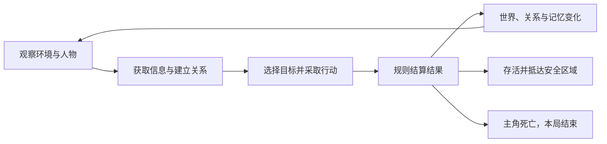

# Real World：游戏介绍与交接入口

| 项目 | 内容 |
| --- | --- |
| 工作名称 | Real World，非最终发行名称 |
| 文档版本 | 0.2 |
| 更新日期 | 2026-11-26 |
| 当前状态 | 概念与构建规划阶段；尚无游戏实现、可玩版本或实测数据 |
| 阅读对象 | 新加入的产品、策划、开发、美术及测试人员 |

## 1. 游戏是什么

Real World 是一款以求生、逃离和人际博弈为核心的单人三维 AI 社会模拟游戏。玩家扮演一名被困在虚构封闭园区中的普通人，在信息不完整、资源有限、人物利益冲突的环境里寻找出路。

游戏主客户端采用 Unity + C#。首版就提供一个可以实际走动、接近人物并交互的三维园区，以较小场景和可复用资产验证玩法；三维人物、建筑、道具和基础动画属于首版交付内容。

世界中的 NPC 各有性格、目标、需求、记忆和人际关系。他们可以主动交谈、交换信息、结成同盟、改变立场，也会在玩家不在场时继续活动。玩家通过观察、交往和行动改变自己的处境，承担由此产生的后果。

游戏希望实现的体验是：**玩家为了活下来，需要理解具体的人，而这些人也会根据共同经历重新理解玩家。**

原始灵感来自用户阅读《被骗到缅北的这些年》（用户提供的作者为“最爱毛康康”、主角为“陈昂”）后，对开放人物关系与自主社会的设想。本项目当前选择原创路线，不直接使用原作角色、剧情、对白或人物关系图。上述书目信息仅记录需求来源，本轮未对原作进行系统考据。

## 2. 已确认的产品决策

这些决定来自本次讨论，是后续文档的共同基线。

| 决策 | 具体含义 |
| --- | --- |
| 单人独立世界 | 每位玩家拥有自己的世界，不共享 NPC、资源或故事进度 |
| Unity 三维客户端 | 主游戏采用 Unity + C#，首版包含三维场景、移动与人物交互 |
| 首先验证逃生与人际博弈 | 首版集中于结交、合作、隐瞒、背叛和逃离 |
| NPC 具备模型驱动能力 | 所有具名 NPC 都能够进行基于自身状态的对话与关键决策；不要求每个时刻都调用模型 |
| 世界在云端持续运行 | 玩家离线时，NPC 与局势继续推进 |
| 离线主角受保护 | 不因离线期间新发生的事件直接死亡；上线时可能面对变化后的环境 |
| 主角死亡结束本局 | 玩家不能读取旧存档撤销结果，只能重新开始 |
| 原创背景与人物 | 原作保留为灵感来源，直接改编需另行确认授权 |
| MVP 面向内部与少量朋友 | 暂不以公开发行、商业收费或大规模运营为目标 |
| 生育成长属于长期愿景 | 首版不实现，但长期规划需要认真处理遗传、养育与环境影响 |

### 2.1 如何阅读决策状态

- **已确认**：上述产品方向，变更时必须同步三份文档。
- **推荐基线**：为便于估算和构建提出的具体方案，可在实现前根据证据调整，不代表用户已逐项确认。
- **待验证**：必须通过原型、测试或预算评估回答的问题，不能写成已经具备的能力。

推荐基线与待验证项分别由 [MVP 构建规划](MVP.md) 和 [长期规划](ROADMAP.md) 维护。Unity 三维路线已确定；具体目标平台、相机视角、画风、渲染管线及精细空间模拟范围仍有推荐基线，需要在实施准备阶段确认。

## 3. 原创世界与玩家身份

### 3.1 世界设定

“灰湾园区”作为原创占位名称，是一个存在出入限制、资源垄断和权力失衡的虚构封闭区域。园区中生活着处境不同的人：受限制的普通劳动者、维持秩序的人、掌握物资的人，以及拥有外部联系的人。

人物没有统一立场。同一名管理者可能希望秩序稳定，也担心失去地位；同一名受困者可能渴望自由，又不愿承担失败的风险。角色的具体决定由利益、关系、可见信息和当时处境共同影响。

该设定不对应具体国家、民族、现实机构或真实案件。名称、布局与人物小传均为后续创作素材，不构成已完成的内容资产。

### 3.2 玩家角色

首版玩家是一个没有特殊权力的原创成年人，文档中暂称“玩家角色”。玩家从有限信息与有限资源起步，没有预知剧情的能力，也不能直接读取 NPC 的隐藏思想。

首版目标是在仍然存活的情况下，抵达游戏规则认可的外部安全区域。仅仅越过一道门或收到某人“你已经自由了”的对白，不代表获胜。

### 3.3 目标玩家与体验取舍

适合喜欢开放叙事、调查、人物关系、策略取舍和不可逆选择的玩家。玩家应能从事件中理解风险，通过行动改善处境，并愿意承担某些选择带来的损失。

首版要让玩家在真实的三维空间中理解人物位置、门与通路、可以接触的物品，以及行动产生的变化。先完成小园区的探索与社会互动，即时动作战斗、电影级演出和超大地图留待后续评估。开放输入也不等于任何自然语言要求都能实现；系统会明确反馈可执行的行动及限制。

## 4. 核心玩法循环

| 玩家行为 | 可以改变什么 | 玩家如何感知后果 |
| --- | --- | --- |
| 观察与打听 | 获得消息、识别习惯、发现矛盾 | 场景描述、对话、可核对的线索 |
| 帮助与交换 | 改变资源、信任、欠情与合作意愿 | 对方实际履约、提供帮助或提高要求 |
| 承诺与隐瞒 | 改变他人判断，也可能积累暴露风险 | 后续质疑、态度改变、传言与冲突 |
| 合作与冒险 | 获得新的行动机会，也承担共同风险 | 成功、损失、受伤、关系破裂或死亡 |
| 等待与休息 | 保持状态，给他人行动时间 | 新事件、地点变化与返回后的摘要 |

行动不需要每次都引发重大剧情。重点是重要行为能够留下可追踪的影响，类似行为在不同人物、关系和环境下产生有依据的不同结果。

## 5. NPC 社会如何运转

### 5.1 一个 NPC 需要什么

| 状态 | 用途 |
| --- | --- |
| 性格与价值观 | 提供稳定的行为倾向，不直接规定唯一答案 |
| 需求与当前目标 | 解释此刻为何采取某个行动 |
| 能力、位置与资源 | 限制实际能够完成的事情 |
| 关系 | 区分信任、畏惧、感激、承诺和利益往来 |
| 已知信息 | 区分亲眼看到的事实、听到的消息和个人猜测 |
| 记忆 | 保留共同经历及其对后续决定的影响 |
| 当前计划 | 维持日常行动，遇到重要变化时重新考虑 |

关系具有方向性：甲信任乙，不代表乙同样信任甲。负面人物也有自保和利益考虑；善意人物也可能在压力下背弃承诺。

### 5.2 模型与游戏规则的职责

模型依据人物能够知道的信息，生成表达、选择目标并提出行动意图。服务器检查行动条件，裁定结果，再更新世界状态和有关人物的记忆。

模型不能凭对白创造物品、直接修改关系数值、宣布别人死亡，或获取未接触的秘密。同一个模型可以服务多个 NPC，但每次请求只得到该角色允许访问的资料。

不安排玩家唯一必须经历的剧情顺序。策划需要设计初始矛盾、资源与行动规则，确保人物有行动理由；运行过程中形成具体故事。剧情是否有趣仍需要试玩验证。

### 5.3 三维表现与世界模拟的分工

| 部分 | 当前路线 | 主要职责 |
| --- | --- | --- |
| 游戏客户端 | Unity + C# | 三维场景、输入、镜头、人物移动、动画、局部导航与界面 |
| 资产制作与加载 | Blender、Unity 导入流程、Addressables | 制作和整理模型、骨骼、材质，按需要加载资源 |
| 后台与持久化 | 推荐 Node.js + Fastify、PostgreSQL、独立 Worker | 模型请求、人物意图、状态结算、日程与离线事件 |
| 首版空间模拟 | 推荐区域、连接通道和交互点的事件模型 | 判断可达性、门权限、交互条件与人物当前活动 |

三维资源数量与大模型调用量分别控制。普通行走、转身和动画由引擎执行，不为每一步调用语言模型；服务器维护世界事实，客户端根据这些事实呈现人物活动。

首版后台不承诺逐帧复现 Unity 的碰撞、视线和战斗。场景与服务器共用空间配置，不能各自维护一套互相矛盾的通路。若玩法以后依赖精确追逐、遮挡或物理结果，应先评估 C# 世界模拟或 Unity 无画面服务器，不能直接认为现有后台已经支持。具体边界见 [MVP 构建规划](MVP.md#55-三维空间与后台模拟边界)。

## 6. 持续世界、离线与永久死亡

### 6.1 持续运行的含义

服务器持续维护人物日程、资源变化、信息传播和事件进展。首版在线与离线都采用同一套区域及事件规则，日常活动由规则执行，冲突和关键决定再调用模型。三维渲染发生在玩家客户端，云端持续运行不要求持续渲染人物和建筑。

玩家重新上线时，看到的是已经保存的事件及局势变化。不能仅在玩家登录时编一段“这段时间发生了什么”，再把它当成真实模拟记录。

### 6.2 离线保护的边界

MVP 推荐采用明确的“受保护休息”规则：已提交的行动先由服务器完整结算，然后停止主角自主冒险。离线不新增致死行动，也不因为饥饿、病情或外部袭击直接结束本局。

如果玩家在线时已经提交一个可能致死的行动，断线不撤销该行动。其结果可能在断线后返回，属于在线决策的结算，不属于离线新增伤害。

NPC 与外界局势仍会变化，某次机会可能消失、盟友可能离开。离线保护不会把整个世界冻结。具体退出与重连流程见 [MVP 构建规划](MVP.md#6-持续运行与离线规则)。

### 6.3 “不能读档”与自动保存

玩家不能主动回到旧状态重做选择。服务器必须自动保存已经提交的结果，以支持重连、进程重启和故障恢复。

推荐基线是：死亡或逃生成功后结束该世界的主动模拟，保留可回顾的本局记录；再次开始时创建独立的新世界，不继承本局物品或关系。首版不增加永久属性强化等跨局成长。

## 7. 一段示例故事

以下是原创说明案例，展示系统需要具备的能力，不是必须发生的剧情脚本。

玩家在公共休息区遇见许乔。玩家把自己的食物分给她，她因此愿意多谈几句，但没有立刻相信玩家提出的逃离计划。之后玩家按约定完成了一次交换，许乔才愿意透露她知道的一条消息。

另一名 NPC 周衡看见了交换，却没有听见谈话。他只知道两人有来往，无法直接知道他们在讨论什么。周衡随后把“他们最近常在一起”告诉了负责人，这条消息增加了关注，却没有立即证明任何计划。

玩家离线后，许乔因自己的处境变化决定暂缓合作。玩家回来时，发现原约定无法继续，可以质问、重新协商、寻找新伙伴，或暂时放弃这条路线。

如果玩家在信息不足时贸然行动，可能失去资源、受伤甚至死亡；如果事先交叉核对消息，也可能发现新的机会。每个后果都应能够追溯到人物所知的信息、行动条件和实际结算。

## 8. MVP 与完整愿景的关系

| 维度 | 短期验证 | 长期方向 |
| --- | --- | --- |
| 地图 | 一个可走动的三维园区，少量连通区域 | 分区加载的更大三维地图、不同权力结构与生活空间 |
| NPC | 小规模具名人物与关系网络 | 更丰富的职业、群体、家庭和社会关系 |
| 目标 | 活着逃离，验证人际选择 | 在验证结果支持下扩展长期生活目标 |
| 时间 | 能感知日程与离线变化 | 处理多年生活、成长与世代变化 |
| 生育 | 不实现 | 遗传、孕育、成长、养育及环境影响 |
| 表现 | Unity 三维场景、基础角色动画与文字对话界面 | 更丰富的三维资产、人物演出与环境细节 |
| 运营 | 内部与少量朋友，控制成本 | 根据质量、留存与成本决定扩张 |

长期愿景仍保留主角死亡结束本局。生育系统不自动意味着玩家能够转为操控后代，多人世界也不属于现阶段承诺。

## 9. 为什么值得验证，哪些尚未成立

已有研究展示了小规模智能体在记忆、计划和反思机制下形成社会互动的可能性，例如 2023 年的 [Generative Agents: Interactive Simulacra of Human Behavior](https://arxiv.org/abs/2304.03442)。其 25 个智能体小镇说明部分技术机制有研究依据，不代表本项目已经验证长期稳定性、游戏性或商业成本。

当前最关键的未知项是：人物能否在长时间运行中保持可信；玩家是否能理解因果而不是感到被随机惩罚；自由对话能否转化为有效行动；离线变化是否有趣；每个独立世界的持续运行成本是否可接受。

## 10. 新人如何接手

1. 先阅读本文件，理解游戏定位、已经确认的决定和关键取舍。
2. 阅读 [MVP.md](MVP.md)，了解首版行为、系统职责、实施阶段和验收场景。
3. 阅读 [ROADMAP.md](ROADMAP.md)，了解长期目标、依赖、进入条件与未解决问题。
4. 开始实现前，先核对 MVP 的待确认项，确认目标设备、引擎与包版本、三维资产、预算和模型条件；不要把本文件的建议当成已有实现。

文档分工：本文件维护产品定位与共同原则；MVP 文档维护首版构建和验收；长期规划维护后续阶段。修改共同原则时应同步检查另外两份文档，避免出现不同版本的死亡、离线或世界共享规则。

当前交接资产只有这三份规划文档。没有已选定的模型供应商、已配置的云资源、完成授权的原作素材、已实现的接口或通过测试的游戏功能。

## 11. 版本记录

| 版本 | 日期 | 变化 |
| --- | --- | --- |
| 0.2 | 2026-11-26 | 按 Unity 三维路线修订首版范围，加入资产制作及客户端与云端模拟分工 |
| 0.1 | 2026-11-26 | 建立游戏定位、单人持续世界、离线保护及永久死亡的初始规划 |
